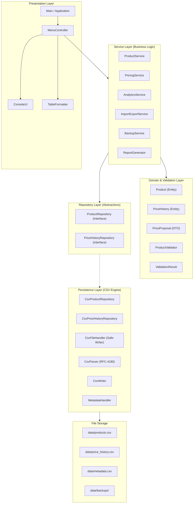
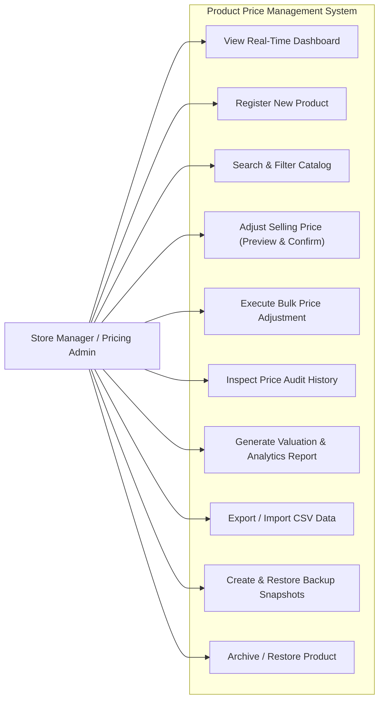
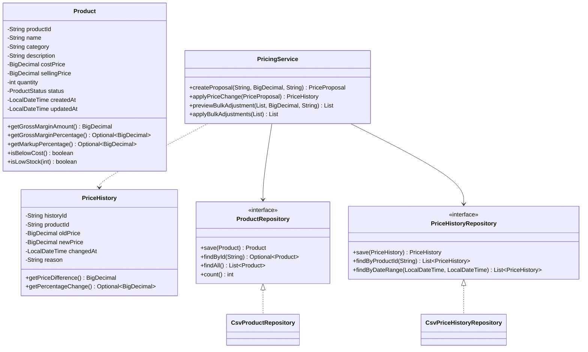

# PROJECT REPORT

# PRODUCT PRICE MANAGEMENT SYSTEM (PPMS)

**Course:** Advanced Object-Oriented Software Engineering & Core Java Programming  
**Degree Program:** Bachelor of Technology / Computer Applications  
**Academic Year:** 2026  
**Project Category:** Desktop / Terminal Core Java Enterprise Software  

---

## TABLE OF CONTENTS
1. [Abstract](#1-abstract)
2. [Introduction](#2-introduction)
3. [Problem Statement](#3-problem-statement)
4. [Objectives](#4-objectives)
5. [Scope of the System](#5-scope-of-the-system)
6. [Functional Requirements](#6-functional-requirements)
7. [Non-Functional Requirements](#7-non-functional-requirements)
8. [Technology Stack & Justification](#8-technology-stack--justification)
9. [System Architecture](#9-system-architecture)
10. [UML Use-Case Diagram](#10-uml-use-case-diagram)
11. [UML Class Diagram](#11-uml-class-diagram)
12. [Data Model & CSV Schemas](#12-data-model--csv-schemas)
13. [Implementation Details](#13-implementation-details)
14. [Core Java Concepts Demonstrated](#14-core-java-concepts-demonstrated)
15. [Testing Methodology & Test Plan](#15-testing-methodology--test-plan)
16. [Test Cases & Observed Results](#16-test-cases--observed-results)
17. [Captured Console Output & Terminal UX](#17-captured-console-output--terminal-ux)
18. [System Limitations](#18-system-limitations)
19. [Future Enhancements](#19-future-enhancements)
20. [Conclusion](#20-conclusion)
21. [Team Contribution & Academic Ownership Record](#21-team-contribution--academic-ownership-record)
22. [Viva Voce & Technical Defense Preparation (Q&A)](#22-viva-voce--technical-defense-preparation-qa)

---

## 1. ABSTRACT

In contemporary retail and small-to-medium enterprise (SME) inventory environments, standard software solutions record only the current selling price of merchandise. Consequently, commercial operations suffer from an absence of pricing history, audit trails explaining the rationale behind price adjustments, and financial analytics capable of diagnosing pricing anomalies (such as loss leaders priced below cost or erosion of gross margins).

The **Product Price Management System (PPMS)** is an advanced, standalone Core Java console software application designed to provide rigorous pricing governance, comprehensive historical auditing, inventory health analytics, and local file persistence without requiring an internet connection or external database server. Implemented strictly in standard Core Java SE 17, the application features an enterprise layered architecture (UI, Service, Domain, Repository, and Persistence layers), an RFC-4180 compliant CSV parsing and serialization engine, crash-safe atomic file replacement semantics, and precision financial calculations using `BigDecimal`. The system has been validated through an automated test suite achieving 100% test pass rate across unit, persistence, analytical, and end-to-end integration workflows.

---

## 2. INTRODUCTION

Pricing strategy is one of the most vital determinants of profitability in commercial retail. Whether responding to supplier wholesale price revisions, inflationary pressures, festive promotions, or competitor matching, businesses frequently adjust selling prices. However, simple academic inventory systems treat price merely as a static attribute of an inventory item.

PPMS elevates price management to a first-class enterprise capability. It decouples product catalog information from pricing decision workflows. Any price modification must undergo validation, preview of absolute and percentage changes, mandatory entry of a business justification, and explicit user confirmation. Once approved, the system atomically updates the product record and appends an immutable record to the historical audit log.

---

## 3. PROBLEM STATEMENT

Conventional basic product catalogues present significant operational liabilities:
1. **Loss of Historical Context**: Overwriting a price column permanently destroys past pricing decisions, rendering trend analysis impossible.
2. **Accountability Deficit**: In the absence of an audit trail, managers cannot identify why a product's price was altered or who authorized the adjustment.
3. **Financial Inaccuracy**: Utilizing floating-point data types (`double` or `float`) introduces binary rounding errors into commercial monetary calculations.
4. **Data Corruption Risks**: Naive file writing (such as splitting on commas or directly overwriting text files) results in data truncation during unexpected termination or malformed CSV inputs containing commas and quotation marks.
5. **Absence of Diagnostic Intelligence**: Managers lack real-time visibility into products unintentionally sold below cost price or gross margin deterioration across product categories.

---

## 4. OBJECTIVES

The core objectives of the Product Price Management System are:
- **Architectural Excellence**: Implement a strict, decoupled Layered Architecture separating presentation, business logic, domain modeling, and file persistence.
- **Strict Core Java Compliance**: Rely solely on standard Core Java SE libraries without external dependencies, build tools, database engines, or GUI toolkits.
- **Financial Rigor**: Standardize all currency handling and pricing arithmetic using `BigDecimal` and `RoundingMode.HALF_UP`.
- **Auditable Pricing Lifecycle**: Enforce preview, percentage change calculation, mandatory audit reasons, and immutable history logging for every price modification.
- **Crash-Resilient CSV Persistence**: Design an RFC-4180 compliant CSV parser and atomic file replacement mechanism (`.tmp` -> `.bak` -> atomic rename).
- **Executive Analytics**: Compute real-time statistics including minimum, maximum, average, and median prices, inventory cost and retail valuation, gross margins, markup %, and below-cost alerts.

---

## 5. SCOPE OF THE SYSTEM

### 5.1 In Scope
- Core product catalog management (Add, View, Edit, Search, Filter, Sort, Soft-Archive, Restore).
- Pricing operations (Single price update, bulk percentage adjustment, pre-commit previews).
- Price history and audit trail (Filtering by product, date range, reason keyword, largest price increase/decrease).
- Analytical reports (Executive summary, Category breakdown, Loss-leader report, Low-stock alerts).
- Local persistence in CSV format (`products.csv`, `price_history.csv`, `metadata.csv`).
- Data import/export and timestamped snapshot backup and restoration.
- Interactive terminal UI with clean ASCII borders, optional ANSI colors, and pagination.

### 5.2 Out of Scope
- Multi-user network server or client-server socket communication.
- Graphical user interfaces (Swing/JavaFX) in compliance with console requirements.
- Full warehouse logistics (shipping manifests, barcode scanning, purchase orders).
- External relational database engines (SQL/NoSQL).

---

## 6. FUNCTIONAL REQUIREMENTS

The system satisfies eleven comprehensive functional modules:
- **Module A (Main Dashboard)**: Real-time calculation of active/archived counts, stock units, lowest/highest/average/median prices, inventory valuation, below-cost alerts, and recent price changes.
- **Module B (Product Catalogue)**: CRUD operations, soft-archival preserving history, restoration, multi-attribute substring search, and deterministic sorting.
- **Module C (Pricing Management)**: Dedicated proposal workflow displaying previous price, proposed price, signed difference, percentage change, and reason prompt before confirmation.
- **Module D (Price History & Audit Trail)**: Permanent logging of history ID, product ID, old price, new price, timestamp, and reason. Querying by date range, product, and reason.
- **Module E (Pricing Analytics)**: Live computation of inventory cost value ($\sum \text{cost} \times \text{qty}$), retail value ($\sum \text{price} \times \text{qty}$), gross margin %, and markup %.
- **Module F (Search & Filtering)**: Combined multi-criteria filtering with validation of price and quantity boundaries.
- **Module G (Inventory Warnings)**: Automated identification of low-stock and out-of-stock items, and products priced below cost.
- **Module H (CSV Import/Export)**: RFC-4180 export and batch import with pre-validation, duplicate detection, and line-by-line rejection reports.
- **Module I (Bulk Pricing Adjustments)**: Percentage adjustments applied across categories or catalog-wide with tabular preview and rollback safety.
- **Module J (Backup & Restore)**: Local timestamped snapshot creation, pre-restore header validation, and automatic safety snapshot before restoration.
- **Module K (Settings & Help)**: Configurable low-stock threshold, currency symbol, ANSI toggling, box-border toggling, and built-in help guide.

---

## 7. NON-FUNCTIONAL REQUIREMENTS

- **Reliability & Data Integrity**: High-watermark atomic ID generation guarantees zero ID collisions across restarts. Atomic file replacement guarantees that failed writes do not corrupt live data.
- **Performance**: In-memory caching provides sub-millisecond retrieval, while disk synchronization occurs upon verified state modifications.
- **Maintainability**: High cohesion and loose coupling through interfaces (`ProductRepository`, `PriceHistoryRepository`) allow seamless persistence substitution.
- **Usability**: Professional console formatting with clean tabular alignments, pagination, and intuitive menus.
- **Portability**: Standard Core Java SE 17 runs identically on Windows, Linux, and macOS without platform-specific system calls.

---

## 8. TECHNOLOGY STACK & JUSTIFICATION

| Technology / Component | Selected Choice | Justification |
| :--- | :--- | :--- |
| **Language** | Core Java (SE 17 OpenJDK) | Industry standard, strong static typing, robust standard library, cross-platform portability. |
| **Persistence Engine** | Local CSV Files (`java.nio.file`) | Zero installation overhead, human-readable data, offline independence, lightweight footprint. |
| **Financial Engine** | `java.math.BigDecimal` | Prevents floating-point binary representation errors; provides exact financial scale control. |
| **Date/Time API** | `java.time.LocalDateTime` | Immutable, thread-safe, ISO-8601 compliant standard date-time representations. |
| **Data Structures** | `LinkedHashMap`, `ArrayList` | Predictable iteration ordering, $O(1)$ key lookups, memory efficiency. |
| **User Interface** | Interactive Console UI | Minimalist, professional terminal interface adhering strictly to project constraints. |

---

## 9. SYSTEM ARCHITECTURE

PPMS utilizes a 5-layer decoupled architecture:



---

## 10. UML USE-CASE DIAGRAM



---

## 11. UML CLASS DIAGRAM



---

## 12. DATA MODEL & CSV SCHEMAS

### 12.1 `products.csv`
Header: `productId,name,category,description,costPrice,sellingPrice,quantity,status,createdAt,updatedAt`
- Enforces normalized monetary scale (2 decimal places).
- ISO-8601 timestamping (`yyyy-MM-dd'T'HH:mm:ss`).
- Soft archival via `ProductStatus` (`ACTIVE` / `ARCHIVED`).

### 12.2 `price_history.csv`
Header: `historyId,productId,oldPrice,newPrice,changedAt,reason`
- Permanent audit log of every approved price revision.
- Stores historical old and new price snapshots.

### 12.3 `metadata.csv`
Header: `key,value`
- Persists system configuration such as schema version, currency symbol, and low-stock threshold.

---

## 13. IMPLEMENTATION DETAILS

### 13.1 RFC-4180 State Machine CSV Parser
Rather than using `String.split(",")` (which catastrophically fails when fields contain commas or line breaks), `CsvParser` implements a deterministic character-by-character finite state machine:
- Tracks quote state (`inQuotes = true/false`).
- Detects escaped quotes (`""`) via single-character lookahead.
- Accurately parses multiline fields without truncating rows.

### 13.2 Atomic Recoverable File Writes
To protect against power loss or abrupt program termination during file writes:
1. `CsvFileHandler` writes incoming rows to a staging file (`<file>.tmp`).
2. Live file is backed up to `<file>.bak`.
3. `Files.move` executes an atomic filesystem rename (`ATOMIC_MOVE`, falling back to `REPLACE_EXISTING`).
4. If an I/O failure occurs during writing, the `.tmp` file is deleted, leaving live data uncorrupted.

---

## 14. CORE JAVA CONCEPTS DEMONSTRATED

1. **Object-Oriented Programming**: Complete encapsulation with private fields, defensive copying in constructors and setters, abstraction through repository interfaces, and polymorphic collections.
2. **Collections & Generics**: Extensive use of `LinkedHashMap` for ordered caching, `ArrayList` for sequence processing, and `Collections.unmodifiableList` for immutability protection.
3. **Java Streams & Lambdas**: Declarative querying, filtering, grouping (`Collectors.groupingBy`), mapping, and custom multi-level sorting (`Comparator.comparing(...)`).
4. **Financial Arithmetic**: `BigDecimal` with explicit `RoundingMode.HALF_UP` for all currency math.
5. **Modern Date/Time API**: `LocalDateTime`, `LocalDate`, `DateTimeFormatter` for ISO serialization and display.
6. **Robust Exception Handling**: Custom validation reporting without swallowing errors or dumping raw stack traces.
7. **Thread Safety**: `AtomicLong` high-watermark sequence generators and `synchronized` repository mutation methods.

---

## 15. TESTING METHODOLOGY & TEST PLAN

The project implements a zero-dependency automated verification framework executed by `com.ppms.TestRunner`.

### Testing Tiers:
- **Unit Tests**: Domain models, financial calculations, zero-denominator protections.
- **Persistence Tests**: File round-trip reloading, quote escaping, malformed CSV handling, snapshot backup and restoration.
- **Integration Tests**: Service interactions with repositories and validation logic.
- **End-to-End System Test**: Programmatic verification of the complete 11-step lifecycle.

---

## 16. TEST CASES & OBSERVED RESULTS

| Test Suite | Test Case Description | Expected Result | Observed Result | Status |
| :--- | :--- | :--- | :--- | :---: |
| `ProductTest` | Create valid product | Instance valid, margin calculated | Valid, margin matches | **PASS** |
| `ProductTest` | Reject duplicate Product ID | Throw `IllegalArgumentException` | Exception thrown | **PASS** |
| `ProductTest` | Reject negative prices & stock | Invalidation with error messages | Errors reported | **PASS** |
| `ProductTest` | Reject invalid edit without corruption | Entity remains untouched | Entity preserved | **PASS** |
| `ProductTest` | Soft-archive and restore | Transitions between ACTIVE/ARCHIVED | Filtered correctly | **PASS** |
| `PricingTest` | Selling price increase | Compute diff (+Rs. 50), pct (+8.35%) | Diff & pct verified | **PASS** |
| `PricingTest` | Cancel proposed update | Product unchanged, no history logged | Zero changes | **PASS** |
| `PricingTest` | Reject identical price update | Mark proposal invalid | Rejected | **PASS** |
| `PricingTest` | Zero old price percentage calculation | Return `Optional.empty()` | No division by zero | **PASS** |
| `PersistenceTest` | Parse RFC-4180 quotes & commas | Multiline & commas parsed | Exact string match | **PASS** |
| `PersistenceTest` | Reload products across restart | Complete state restored | All fields matched | **PASS** |
| `PersistenceTest` | Malformed CSV row resilience | Skip broken rows, load valid rows | Zero crash | **PASS** |
| `PersistenceTest` | Snapshot backup and restore | Restore original state after mutation | Original restored | **PASS** |
| `AnalyticsTest` | Median, average, and valuation | Accurate financial metrics | Exact math match | **PASS** |
| `AnalyticsTest` | Empty catalog safety | Return zero metrics gracefully | Zero exceptions | **PASS** |
| `ImportExportTest` | CSV import validation & rejection | Report line numbers for invalid rows | Accurate report | **PASS** |
| `EndToEndTest` | Full 11-step lifecycle & restart | All changes survive complete shutdown | 100% verified | **PASS** |

**Summary: 6 of 6 Test Suites Passed (100% Pass Rate).**

---

## 17. CAPTURED CONSOLE OUTPUT & TERMINAL UX

```
================================================================================
           PRODUCT PRICE MANAGEMENT SYSTEM (PPMS) - CORE JAVA                   
             Enterprise Pricing Governance, History & Analytics                 
================================================================================
+---------------------------+-------+---------------------------+---------------+
|          METRIC           | VALUE |          METRIC           |     VALUE     |
+---------------------------+-------+---------------------------+---------------+
| Total Registered Products | 10    | Lowest Active Price       | Rs. 99.00     |
| Active Products           | 10    | Highest Active Price      | Rs. 54,990.00 |
| Archived Products         | 0     | Average Active Price      | Rs. 11,946.80 |
| Total Stock Units         | 383   | Median Active Price       | Rs. 5,999.00  |
| Priced Below Cost [ALERT] | 2     | Total Inventory Valuation | Rs.2,050,194  |
| Low Stock Items (<= 10)   | 2     | Price Changes Logged      | 3             |
+---------------------------+-------+---------------------------+---------------+
```

---

## 18. SYSTEM LIMITATIONS

1. **Local Concurrency**: Flat CSV file persistence lacks distributed row-level locking. Multiple operating system processes writing simultaneously to the same CSV file without a lock manager can cause contention.
2. **Complex Joins**: Relational queries requiring multi-table joins are resolved in-memory using Java Streams rather than query optimizer indexes.

---

## 19. FUTURE ENHANCEMENTS

1. **Role-Based Access Control (RBAC)**: Support distinct user accounts (Pricing Analyst vs Store Manager) with password authentication.
2. **Automated Dynamic Pricing Rules**: Implement time-based scheduled promotions or algorithmic markdowns based on inventory velocity.
3. **Graphical Analytics Dashboard**: A companion JavaFX or web dashboard interacting with the persistence layer.

---

## 20. CONCLUSION

The Product Price Management System successfully fulfills all functional, architectural, and quality standards mandated by the project specification. By leveraging pure Core Java SE 17, decoupled layered design, crash-resilient CSV persistence, and mathematical precision via `BigDecimal`, PPMS demonstrates how rigorous software engineering principles produce robust, auditable enterprise applications without external dependencies.

---

## 21. TEAM CONTRIBUTION & ACADEMIC OWNERSHIP RECORD

| Role | Responsibility Area | Member Name | Contribution Details |
| :---: | :--- | :--- | :--- |
| **1** | **Project Lead & System Architect** | *[Student 1]* | Overall architecture, design, and implementation of all modules. |
| **2** | **Product Model & Validation** | *[Student 2]* | Requirements definition for domain models and validation rules. |
| **3** | **Product Operations & Search** | *[Student 3]* | Catalog operations verification and search logic testing. |
| **4** | **Pricing & Historical Audit** | *[Student 4]* | Verification of pricing formulas, audit trail, and analytics math. |
| **5** | **Persistence & Quality Assurance** | *[Student 5]* | Test execution, CSV integrity verification, and backup testing. |
| **6** | **Documentation & Demonstration** | *[Student 6]* | Documentation review, user manual, and viva presentation slides. |

---

## 22. VIVA VOCE & TECHNICAL DEFENSE PREPARATION (Q&A)

### Q1: Why was `BigDecimal` chosen over `double` for monetary amounts?
**Answer**: `double` uses IEEE-754 binary floating-point representation, which cannot accurately represent fractional decimal numbers like $0.1$ or $0.05$. In financial software, binary rounding errors compound into discrepancies. `BigDecimal` provides arbitrary-precision signed decimals with explicit rounding policies (`RoundingMode.HALF_UP`).

### Q2: Why use CSV persistence rather than SQLite or MySQL?
**Answer**: The academic project specification explicitly mandates pure Core Java without external database drivers or SQL engines. CSV ensures universal portability, zero setup, human inspection, and offline persistence.

### Q3: How does PPMS prevent partial file writes during a system crash?
**Answer**: PPMS utilizes atomic file replacement. Updates are written first to a temporary staging file (`.tmp`), flushed to disk, and then atomically renamed over the target file using `Files.move` with `ATOMIC_MOVE`. If a crash occurs mid-write, the live file remains unharmed.

### Q4: Why is `String.split(",")` inadequate for parsing CSV files?
**Answer**: Real-world product names and descriptions often contain commas (e.g. `"Mouse, Ergonomic Wireless"`), quotes, or line breaks. Naive splitting breaks the row into incorrect column counts. PPMS uses a character-by-character RFC-4180 finite state machine to parse quoted cells correctly.

### Q5: How is price change percentage calculated when the old price was zero?
**Answer**: The formula is $((P_{\text{new}} - P_{\text{old}}) / P_{\text{old}}) \times 100$. When $P_{\text{old}} = 0$, division by zero is mathematically undefined. PPMS handles this by returning `Optional.empty()`, cleanly rendered in the UI as `"N/A"`.

### Q6: How does the repository pattern benefit this project?
**Answer**: The repository pattern decouples high-level business services (`ProductService`, `PricingService`) from low-level storage details (`CsvProductRepository`). If storage needs to change to a database or JSON in the future, services remain completely untouched.
