> **GitHub Repository:** [https://github.com/Irfaninsync/ProductPriceManagementSystem](https://github.com/Irfaninsync/ProductPriceManagementSystem)

# System Architecture — Product Price Management System (PPMS)

## 1. Architectural Style: Layered Architecture

PPMS adheres to a strict, decoupled Layered Architecture designed in pure Core Java (SE 17), with zero external framework dependencies.

```mermaid
flowchart TD
    subgraph PresentationLayer ["Presentation Layer (Console UI)"]
        Main["Main / Application"] --> MenuController["MenuController"]
        MenuController --> ConsoleUI["ConsoleUI"]
        MenuController --> TableFormatter["TableFormatter"]
    end

    subgraph ServiceLayer ["Service Layer (Business Logic)"]
        ProductService["ProductService"]
        PricingService["PricingService"]
        AnalyticsService["AnalyticsService"]
        ImportExportService["ImportExportService"]
        BackupService["BackupService"]
        ReportGenerator["ReportGenerator"]
    end

    subgraph ValidationLayer ["Validation & Domain Layer"]
        ProductValidator["ProductValidator"]
        ValidationResult["ValidationResult"]
        Product["Product (Entity)"]
        PriceHistory["PriceHistory (Entity)"]
        ProductStatus["ProductStatus (Enum)"]
        PriceProposal["PriceProposal (DTO)"]
        AnalyticsSummary["AnalyticsSummary (DTO)"]
    end

    subgraph RepositoryLayer ["Repository Layer (Abstractions)"]
        ProductRepo["ProductRepository (Interface)"]
        PriceHistoryRepo["PriceHistoryRepository (Interface)"]
    end

    subgraph PersistenceLayer ["Persistence Layer (CSV Storage Engine)"]
        CsvProductRepo["CsvProductRepository"]
        CsvPriceHistoryRepo["CsvPriceHistoryRepository"]
        CsvFileHandler["CsvFileHandler (Atomic Safe-Writer)"]
        CsvParser["CsvParser (RFC-4180 State Machine)"]
        CsvWriter["CsvWriter (RFC-4180 Escaper)"]
        MetadataHandler["MetadataHandler"]
    end

    subgraph StorageLayer ["Local File System"]
        ProductsCsv["data/products.csv"]
        HistoryCsv["data/price_history.csv"]
        MetadataCsv["data/metadata.csv"]
        Backups["data/backups/backup_*/"]
    end

    MenuController --> ProductService
    MenuController --> PricingService
    MenuController --> AnalyticsService
    MenuController --> ImportExportService
    MenuController --> BackupService
    MenuController --> ReportGenerator

    ProductService --> ProductValidator
    ProductService --> ProductRepo
    PricingService --> ProductValidator
    PricingService --> ProductRepo
    PricingService --> PriceHistoryRepo
    AnalyticsService --> ProductRepo
    AnalyticsService --> PriceHistoryRepo
    BackupService --> ProductRepo
    BackupService --> PriceHistoryRepo

    ProductRepo -.-> CsvProductRepo
    PriceHistoryRepo -.-> CsvPriceHistoryRepo

    CsvProductRepo --> CsvFileHandler
    CsvPriceHistoryRepo --> CsvFileHandler
    CsvFileHandler --> CsvParser
    CsvFileHandler --> CsvWriter

    CsvFileHandler --> ProductsCsv
    CsvFileHandler --> HistoryCsv
    MetadataHandler --> MetadataCsv
    BackupService --> Backups
```

---

## 2. Layer Responsibilities

### 2.1 Presentation Layer (`com.ppms.ui`, `com.ppms.app`)
- **Main / Application**: Bootstraps dependency injection, checks persistent data directories, bootstraps sample demonstration data on clean install, and initiates console event loop.
- **MenuController**: Coordinates user interactions across Catalog, Pricing, History, Analytics, Data Management, and Settings.
- **ConsoleUI**: Manages terminal input parsing, optional ANSI color styling, user prompts, input range checking, and paginated rendering.
- **TableFormatter**: Dynamic table rendering supporting clean plain-text ASCII borders (`+---`, `|`) and optional Unicode box borders.

### 2.2 Service Layer (`com.ppms.service`)
- Enforces enterprise pricing governance rules.
- Coordinates cross-repository state changes.
- **ProductService**: Manages catalog lifecycle (add, edit, soft-archive, restore, multi-criteria filter, deterministic sort).
- **PricingService**: Governs the selling price adjustment lifecycle, computes difference and percentage change previews, rejects identical prices, updates the product entity, and logs an immutable `PriceHistory` audit entry.
- **AnalyticsService**: Calculates live metrics without hardcoding (min, max, avg, median prices, cost valuation, retail valuation, gross margin %, markup %, below-cost items, low-stock items).
- **ImportExportService**: Manages RFC-4180 CSV file export and structured batch imports with pre-validation and row-level rejection reporting.
- **BackupService**: Creates timestamped directory snapshots, validates header integrity prior to restoration, and takes safety snapshots before overwriting live data.

### 2.3 Domain & Validation Layer (`com.ppms.model`, `com.ppms.validation`)
- **Product**: Encapsulates entity state, defensive copying, financial normalizations, and inventory calculations.
- **PriceHistory**: Represents an immutable audit record for approved selling price adjustments.
- **ProductValidator**: Centralized business rule checking preventing partial modifications on invalid input.
- **ValidationResult**: Clean error aggregation container.

### 2.4 Repository & Persistence Layer (`com.ppms.repository`, `com.ppms.persistence`)
- Repository interfaces (`ProductRepository`, `PriceHistoryRepository`) abstract file I/O from business services.
- **CsvFileHandler**: Atomic write mechanism writing first to a staging `.tmp` file, updating a `.bak` backup copy, and executing atomic replacement (`ATOMIC_MOVE` or `REPLACE_EXISTING`).
- **CsvParser**: Character-by-character RFC-4180 state machine handling embedded commas, quotes, CRLF, and multiline fields without naive line splitting.

---

## 3. High-Watermark ID Generation Architecture

To ensure permanent, collision-free identifiers without relying on an external database sequence:
1. `IdGenerator` maintains an atomic counter initialized to 1000.
2. During CSV parsing at application startup, `observeId(String id)` extracts numeric suffixes from all existing records in `products.csv` and `price_history.csv`.
3. The counter atomically advances to `Math.max(current, observedId)`.
4. Archived or soft-deleted items preserve their sequence numbers, preventing identifier recycling.

---
**GitHub Repository:** [https://github.com/Irfaninsync/ProductPriceManagementSystem](https://github.com/Irfaninsync/ProductPriceManagementSystem)
