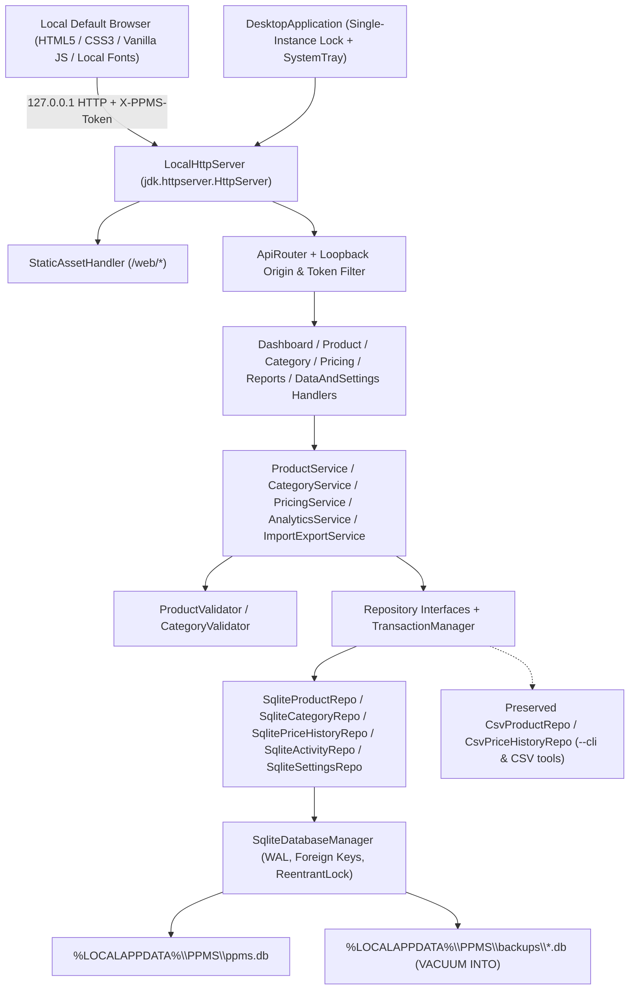

> **GitHub Repository:** [https://github.com/Irfaninsync/ProductPriceManagementSystem](https://github.com/Irfaninsync/ProductPriceManagementSystem)

# System Architecture — Product Price Management System (PPMS v2.0)

## 1. Local-First Layered Architecture

PPMS executes entirely on one computer with **zero cloud hosting, zero remote databases, and zero external web CDNs**:

## 2. Database & Transaction Guarantees
- **Fixed-Point Monetary Storage:** All currency columns (`cost_price_minor`, `selling_price_minor`, `old_price_minor`, `new_price_minor`) store exact 2-decimal minor units as `INTEGER` (`BigDecimal.movePointRight(2).longValueExact()`), eliminating IEEE-754 floating-point drift inside SQLite.
- **ACID Price Updates:** `PricingService.applyPriceChange(...)` and `applyBulkAdjustments(...)` execute inside `SqliteDatabaseManager.inTransaction(...)`, ensuring `products`, `price_history`, and `activity_log` commit or roll back together.
- **Safe Backup & Restore:** Backups use `VACUUM INTO ?` for consistent hot snapshots. Restoration validates `PRAGMA integrity_check;` and core table existence in read-only mode, captures an automatic pre-restore safety snapshot, closes active handles cleanly, and replaces `ppms.db` atomically.

## 3. Security Boundaries
- Bound strictly to `127.0.0.1` (`InetAddress.getByName("127.0.0.1")`).
- Validates loopback `Host` and `Origin` headers; enforces a per-launch random `X-PPMS-Token` injected into `index.html` for all state-changing HTTP methods (`POST`, `PUT`, `DELETE`).
- Uses parameterized `PreparedStatement` queries and allowlisted sort keys exclusively.
- Resolves backup/export file operations inside sandboxed directories with path-traversal checks.

---
**GitHub Repository:** [https://github.com/Irfaninsync/ProductPriceManagementSystem](https://github.com/Irfaninsync/ProductPriceManagementSystem)
